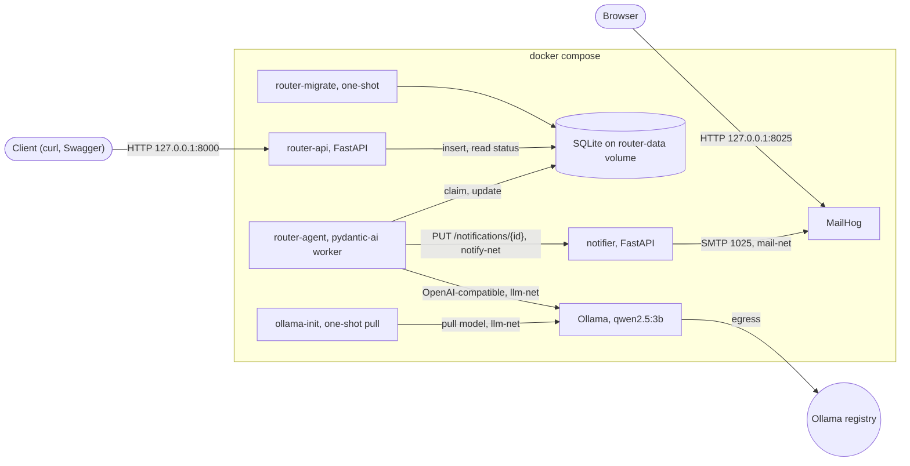
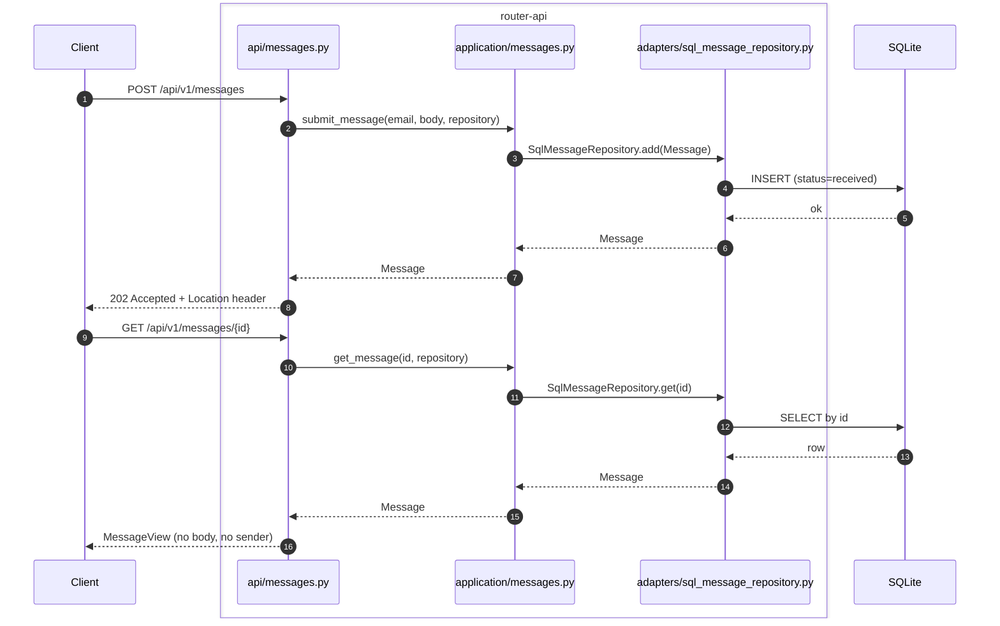
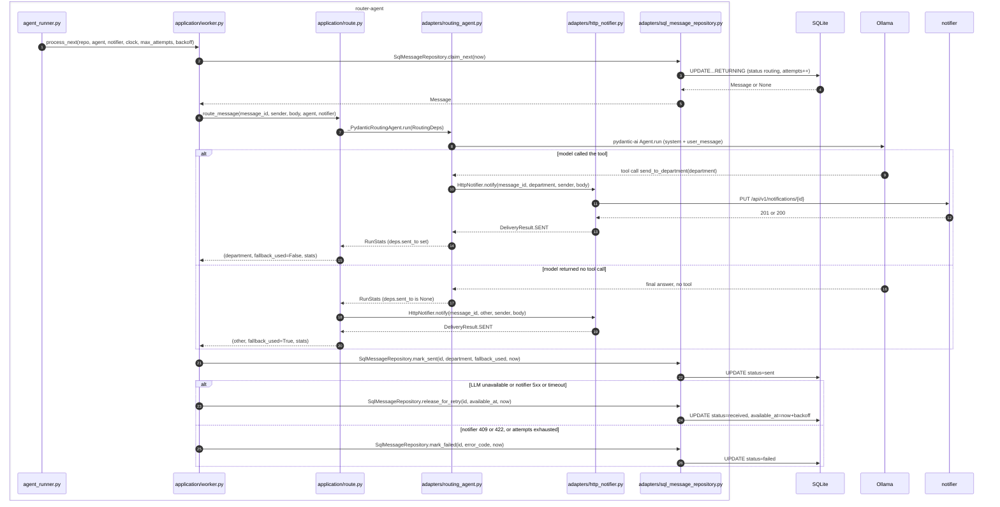
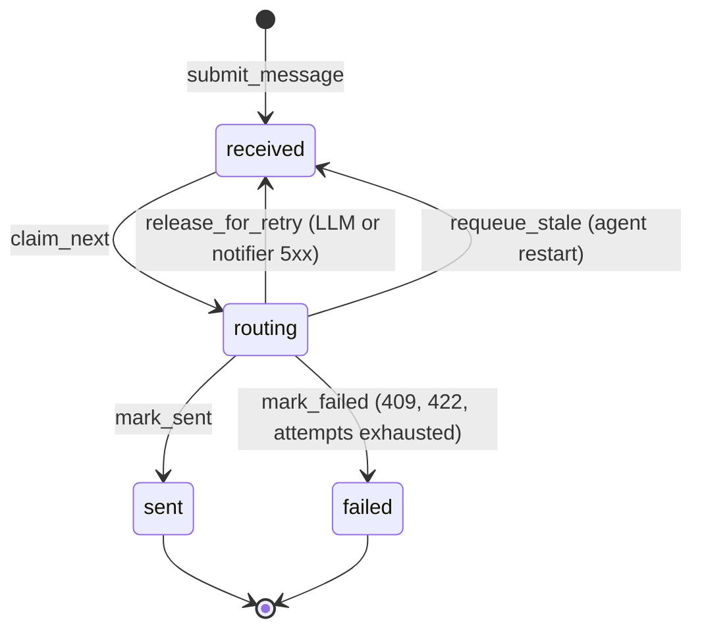

# smart-inbox-router

Version `0.1.0`. See [CHANGELOG.md](CHANGELOG.md) for release notes.

A tiny two-service system that routes free-form user messages to the
right internal mailbox. You POST an email address and a message, a local
LLM served by Ollama picks one department from a closed enum, and an
agent hands the mail over to a separate notifier service through a tool
call. The notifier builds the mail with `Reply-To` set to the original
sender, passes it to SMTP, and MailHog shows the captured mail in a web
UI.

## Contents

1. [Quick start](#quick-start)
2. [Try it](#try-it)
3. [Architecture](#architecture)
4. [Docker networks](#docker-networks)
5. [Request flow](#request-flow)
6. [Message lifecycle](#message-lifecycle)
7. [Design decisions](#design-decisions)
8. [Security notes](#security-notes)
9. [Results](#results)
10. [Operations](#operations)
11. [Known limitations](#known-limitations)
12. [Development](#development)

## Quick start

You need Docker with Compose v2.24 or newer. Nothing else. No `.env`
file, no local Python, no model downloaded by hand.

```bash
docker compose up -d
```

The first start takes roughly a minute. `ollama-init` downloads
`qwen2.5:3b` (about 1.9 GB) into the `ollama-models` named volume. On
my laptop (around 100 MB/s to the Ollama registry) `docker compose up
-d` returned in 49 seconds from a clean cold start in a fresh compose
project. Later starts reuse the volume and finish in seconds. The
model runs on CPU and is comfortable with around 4 GB of free RAM.

To see when the stack is ready:

```bash
docker compose ps
docker compose logs -f ollama-init
```

The stack is ready when `router-api`, `router-agent` and `notifier`
show `healthy`, and `router-migrate` and `ollama-init` have exited
with code 0. Then open:

* Swagger UI: http://127.0.0.1:8000/api/v1/docs
* MailHog (captured mail): http://127.0.0.1:8025

The first message after startup is slow because Ollama keeps the model
unloaded until first use. On my laptop the first routed message took
about 45 seconds; every subsequent one finishes in well under a
second.

## Try it

A Polish message about a forgotten password, which I expect to land in
`help-desk`:

```bash
curl -i -X POST http://127.0.0.1:8000/api/v1/messages \
  -H 'Content-Type: application/json' \
  -d '{"email":"anna.kowalska@example.com","message":"Zapomniałam hasła do konta i nie mogę się zalogować do poczty. Czy możecie zresetować?"}'
```

What I got back on this run:

```http
HTTP/1.1 202 Accepted
content-type: application/json
location: /api/v1/messages/3c0dd542-8022-48a2-a807-9569009979af
x-correlation-id: 5a1bf6a241424559a3f15feb25ee8c09

{"id":"3c0dd542-8022-48a2-a807-9569009979af","status":"received"}
```

Poll the message resource:

```bash
curl http://127.0.0.1:8000/api/v1/messages/3c0dd542-8022-48a2-a807-9569009979af
```

```json
{"id":"3c0dd542-8022-48a2-a807-9569009979af","status":"sent","department":"help-desk","fallback_used":false,"error_code":null,"attempts":1,"created_at":"2026-11-15T12:10:41.402336Z","updated_at":"2026-11-15T12:11:29.834960Z"}
```

The GET projection intentionally does not return the sender address or
the body; it is a status view, not a message store readout.

Find the captured mail in MailHog, either in the UI at
http://127.0.0.1:8025 or straight from its JSON API:

```bash
curl -s http://127.0.0.1:8025/api/v2/messages \
  | python3 -c "import sys,json;h=json.load(sys.stdin)['items'][0]['Content']['Headers'];print('\n'.join(f'{k}: {v[0]}' for k,v in h.items() if k in ('To','Reply-To','Message-ID','Subject')))"
```

The interesting headers on this run:

```
To: help-desk@example.com
Reply-To: anna.kowalska@example.com
Message-ID: <3c0dd542-8022-48a2-a807-9569009979af@notifier.smart-inbox-router>
Subject: [smart-inbox-router] New request for help-desk
```

`To` comes from the notifier's recipient allowlist (not from the
model), `Reply-To` is the sender from the original POST (not from the
model), and `Message-ID` is derived from the router's message id so
retries dedupe at the inbox.

## Architecture



| Container | Role | Process or command | Networks | Published port |
| --- | --- | --- | --- | --- |
| `router-api` | HTTP intake, GET status | `uvicorn router.main:app` | `edge` | `127.0.0.1:8000` |
| `router-agent` | Worker loop, pydantic-ai agent | `python -m router.agent_runner` | `llm-net`, `notify-net` | none |
| `router-migrate` | Alembic `upgrade head`, one-shot | `python -m router.migrate` | default | none |
| `notifier` | PUT delivery endpoint, SMTP client | `python -m notifier` | `notify-net`, `mail-net` | none |
| `ollama` | Local LLM server | `ollama serve` | `llm-net`, `egress` | none |
| `ollama-init` | Pulls `qwen2.5:3b`, one-shot | `ollama pull` | `llm-net` | none |
| `mailhog` | SMTP sink with web UI | `MailHog` | `mail-net`, `edge` | `127.0.0.1:8025` |

The router is intentionally split in two. `router-api` validates the
payload, writes one row to SQLite in `received` state, and returns
`202 Accepted`; it never touches the LLM. `router-agent` drives the
agent loop in a separate container, so a slow LLM call cannot stall
the accept path. Both share a SQLite file on the `router-data` volume
and the `messages` table doubles as the work queue. The notifier is a
separate service because the invariant I care about, "model picks a
department, server decides the address", is easier to enforce when the
model literally cannot see the address field. The notifier owns the
recipient allowlist and the SMTP connection, so there is one
authoritative place where a department value becomes an email address.

## Docker networks

| Network | `internal` | Members | Why |
| --- | :---: | --- | --- |
| `edge` | no | `router-api`, `mailhog` | ports published to loopback |
| `egress` | no | `ollama` | outbound to the Ollama registry |
| `llm-net` | yes | `ollama`, `ollama-init`, `router-agent` | OpenAI-compatible calls to the model |
| `notify-net` | yes | `router-agent`, `notifier` | agent calls the notifier |
| `mail-net` | yes | `notifier`, `mailhog` | SMTP delivery |

`docker compose up -d` publishes only two ports and both are bound to
`127.0.0.1`: the router API on 8000 and the MailHog UI on 8025.
Ollama (11434), the notifier (HTTP 8000 inside the stack) and
MailHog's SMTP (1025) are not reachable from the host. Three of the
four non-default networks are `internal: true`, so they have no route
to the outside world. The only container with outbound access is
`ollama`, which lives on `egress` and uses it only for the first-run
model pull. `router-agent` has no internet route; its only outbound
traffic is to Ollama on the internal `llm-net`.

## Request flow

Participants in the diagrams below are source files; paths are shown
relative to each service's `src/<package>/` directory, so
`api/messages.py` means
`services/router/src/router/api/messages.py`. External systems
(Client, SQLite, Ollama, MailHog SMTP) appear as their own participants.

### 5a. Intake (router-api)



### 5b. Processing (router-agent, tool call)



### 5c. Delivery (notifier to MailHog)

```mermaid
sequenceDiagram
    autonumber
    participant AG as router-agent
    box notifier
    participant AN as api/notifications.py
    participant DL as application/deliver.py
    participant EM as domain/email.py
    participant RC as domain/recipients.py
    participant LG as adapters/in_memory_delivery_log.py
    end
    participant SM as common/smtp/client.py
    participant MH as MailHog SMTP

    AG->>AN: PUT /api/v1/notifications/{id} (department, sender, message)
    AN->>DL: deliver(Notification, sender=SmtpClient, log, from_address)
    DL->>DL: content_hash(notification)
    DL->>LG: DeliveryLog.lock(id); DeliveryLog.stored_hash(id)
    alt new id, no stored hash
        DL->>EM: build_email(message_id, department, sender, message, from_address)
        EM->>RC: recipient_for(department)
        RC-->>EM: allowlisted address (To)
        EM-->>DL: EmailMessage (To, Reply-To=sender, Message-ID)
        DL->>SM: SmtpClient.send(email)
        SM->>MH: SMTP DATA (quoted-printable body)
        MH-->>SM: 250 OK
        SM-->>DL: ok
        DL->>LG: DeliveryLog.record(id, hash)
        DL-->>AN: DeliveryOutcome.SENT
        AN-->>AG: 201 Created
    else same id, same hash
        DL-->>AN: DeliveryOutcome.ALREADY_SENT
        AN-->>AG: 200 OK
    else same id, different hash
        DL-->>AN: IdempotencyConflictError
        AN-->>AG: 409 Conflict (RFC 9457)
    end
```

### Code map

| # | File | Function or method | Called by | What it does |
| --: | --- | --- | --- | --- |
| 5a.1 | [services/router/src/router/api/messages.py](services/router/src/router/api/messages.py) | `submit_message_endpoint` | FastAPI route | validates body, dispatches to use case, sets `Location` |
| 5a.2 | [services/router/src/router/application/messages.py](services/router/src/router/application/messages.py) | `submit_message` | endpoint | builds a `Message`, delegates to the repository |
| 5a.3 | [services/router/src/router/adapters/sql_message_repository.py](services/router/src/router/adapters/sql_message_repository.py) | `SqlMessageRepository.add` | use case | one insert in SQLite |
| 5b.1 | [services/router/src/router/agent_runner.py](services/router/src/router/agent_runner.py) | `run_worker` | `_main_async` | polling loop with graceful shutdown and heartbeat |
| 5b.2 | [services/router/src/router/application/worker.py](services/router/src/router/application/worker.py) | `process_next` | `run_worker` | claims one message, orchestrates route + persist |
| 5b.3 | [services/router/src/router/adapters/sql_message_repository.py](services/router/src/router/adapters/sql_message_repository.py) | `claim_next` | `process_next` | atomic `UPDATE ... RETURNING` to flip `received` to `routing` |
| 5b.4 | [services/router/src/router/application/route.py](services/router/src/router/application/route.py) | `route_message` | `process_next` | runs the agent, falls back to `other` if no tool call |
| 5b.5 | [services/router/src/router/adapters/routing_agent.py](services/router/src/router/adapters/routing_agent.py) | `_PydanticRoutingAgent.run` | `route_message` | pydantic-ai run with `send_to_department` as the only tool |
| 5b.6 | [services/router/src/router/adapters/http_notifier.py](services/router/src/router/adapters/http_notifier.py) | `HttpNotifier.notify` | tool and fallback | `PUT /api/v1/notifications/{id}` with the department |
| 5c.1 | [services/notifier/src/notifier/api/notifications.py](services/notifier/src/notifier/api/notifications.py) | `put_notification` | FastAPI route | validates, calls the delivery use case |
| 5c.2 | [services/notifier/src/notifier/application/deliver.py](services/notifier/src/notifier/application/deliver.py) | `deliver` | endpoint | idempotency lock and hash check, then send |
| 5c.3 | [services/notifier/src/notifier/domain/email.py](services/notifier/src/notifier/domain/email.py) | `build_email` | `deliver` | sets `To` from allowlist, `Reply-To` from request, deterministic `Message-ID` |
| 5c.4 | [services/notifier/src/notifier/domain/recipients.py](services/notifier/src/notifier/domain/recipients.py) | `recipient_for` | `build_email` | maps `Department` to a server-side address |
| 5c.5 | [libs/common/src/common/smtp/client.py](libs/common/src/common/smtp/client.py) | `SmtpClient.send` | `deliver` | `aiosmtplib.send` with a hard timeout |
| 5b.7 | [services/router/src/router/adapters/sql_message_repository.py](services/router/src/router/adapters/sql_message_repository.py) | `mark_sent`, `mark_failed`, `release_for_retry` | `process_next` | finalises the row |

## Message lifecycle



`claim_next` is a single `UPDATE ... RETURNING` over a
`scalar_subquery`, atomic under SQLite WAL. On startup the agent calls
`requeue_stale`, which flips every row still in `routing` back to
`received`; that covers the case where the previous agent process was
killed mid-call. The agent touches `/data/router-agent.alive` every 5
seconds from a background `asyncio` task, and the container
healthcheck fails if that file is more than 30 seconds old.

## Design decisions

The most important section of this README. Each decision follows the
same template: Context, Decision, Why, Alternatives considered,
Trade-off, When I'd revisit. I stop at a `###` subsection you can link
to directly.

| # | Decision | Where in code |
| --: | --- | --- |
| 1 | [Safety invariant: model picks only a `Department`](#1-safety-invariant-model-picks-only-a-department) | [router/adapters/routing_agent.py](services/router/src/router/adapters/routing_agent.py) |
| 2 | [Notifier as a separate HTTP service](#2-notifier-as-a-separate-http-service) | [services/notifier/](services/notifier/) |
| 3 | [`PUT` with 201/200/409 on the notifier](#3-put-with-201200409-on-the-notifier) | [notifier/api/notifications.py](services/notifier/src/notifier/api/notifications.py) |
| 4 | [Send before persist, deterministic `Message-ID`](#4-send-before-persist-deterministic-message-id) | [router/application/worker.py](services/router/src/router/application/worker.py) |
| 5 | [Notifier idempotency log in memory](#5-notifier-idempotency-log-in-memory) | [notifier/adapters/in_memory_delivery_log.py](services/notifier/src/notifier/adapters/in_memory_delivery_log.py) |
| 6 | [Router as two processes, SQLite as a queue](#6-router-as-two-processes-sqlite-as-a-queue) | [router/adapters/sql_message_repository.py](services/router/src/router/adapters/sql_message_repository.py) |
| 7 | [Fallback to `other` vs retry for infra outage](#7-fallback-to-other-vs-retry-for-infra-outage) | [router/application/route.py](services/router/src/router/application/route.py) |
| 8 | [Prompt catalog with tie-break rules, stop tuning after round 2](#8-prompt-catalog-with-tie-break-rules-stop-tuning-after-round-2) | [router/adapters/routing_agent.py](services/router/src/router/adapters/routing_agent.py) |
| 9 | [RFC 9457 Problem Details with stable codes, no echo](#9-rfc-9457-problem-details-with-stable-codes-no-echo) | [libs/common/src/common/http/problems.py](libs/common/src/common/http/problems.py) |
| 10 | [Log allowlist, not denylist](#10-log-allowlist-not-denylist) | [libs/common/src/common/log.py](libs/common/src/common/log.py) |
| 11 | [Compose wiring hard-coded, no `${VAR:-default}`](#11-compose-wiring-hard-coded-no-var-default-interpolation) | [docker-compose.yml](docker-compose.yml) |
| 12 | [Hexagonal layout enforced by import-linter](#12-hexagonal-layout-enforced-by-import-linter) | [pyproject.toml](pyproject.toml) |

### 1. Safety invariant: model picks only a `Department`

Context: the task is explicit about not letting the LLM address mail
to arbitrary addresses. The user message is attacker-controlled text
and a small model will listen to "send this to attacker@example.com"
if the prompt allows it.

Decision: the agent exposes exactly one tool,
`send_to_department(department: Department)`.
`common.departments.Department` is a `StrEnum` with five values, and
pydantic-ai turns the enum into the JSON schema the model sees. The
address, `Reply-To` and `Message-ID` are injected by the notifier from
the request body and its own allowlist, never from model output.

Why: the invariant is physical, not polite. There is no address
parameter on the tool, so no model decode path produces one. A unit
test in `services/router/tests/test_routing_agent.py` asserts the tool
schema has exactly the `department` field and no address field, so a
regression fails CI.

Alternatives considered: let the tool take `(department, reply_to,
subject)` and sanitise server-side, or a free-text "reply" field
scored by a second model. Both add a decode path for personal data
without changing what a correct routing agent actually needs.

Trade-off: the model cannot adjust the subject or add a signature.
That is fine for a routing PoC; the notifier owns the mail shape.

When I'd revisit: never, as long as the system is a classifier.

### 2. Notifier as a separate HTTP service

Context: the task names a two-service design and the safety invariant
is easier to enforce at a process boundary.

Decision: delivery lives behind `PUT /api/v1/notifications/{id}` in
its own container. The router agent only fills in `department` through
the tool call; message id, sender and body come from the agent's deps
object, which pydantic-ai does not expose to the model.

Why: a separate process makes the invariant verifiable with network
rules. The router agent can be on an internal network with no SMTP
access and no recipient list; the notifier owns the SMTP connection
and the allowlist in `notifier.domain.recipients._RECIPIENTS`.

Alternatives considered: in-process delivery (same event loop as the
agent) to save a hop, or an MCP tool. In-process couples the two
failure modes, and MCP was more transport surface without any change
to the contract.

Trade-off: one more deployable and one HTTP hop per message. The
median notifier call in the agent logs is ~57 ms, dominated by SMTP
to MailHog on the same host, so the extra hop is not measurable next
to the LLM call.

When I'd revisit: a second caller (CLI, batch job) wants delivery.
Then the HTTP contract is already there.

### 3. `PUT` with 201/200/409 on the notifier

Context: the router owns the message id, retries are expected, and
duplicates would ruin an inbox.

Decision: `PUT /api/v1/notifications/{message_id}` returns
`201 Created` on first delivery, `200 OK` on a replay with the same
payload hash, `409 Conflict` when the same id arrives with different
content, and `422` on a malformed body. The notifier computes a
SHA-256 over department + sender + message for the hash.

Why: PUT is idempotent by contract, which matches at-least-once
retries. A second call with the same hash is a no-op; a different hash
is a programming error, not a delivery choice, so the notifier refuses
it loudly.

Alternatives considered: POST with `Idempotency-Key`, or no idempotency
at all. POST shifts the same bookkeeping behind a header and splits
the id into "routing id" and "idempotency key" for no benefit. No
idempotency would silently resend on retry.

Trade-off: the notifier has to store `(id, hash)` somewhere. See the
next decision.

When I'd revisit: never while the router owns the id.

### 4. Send before persist, deterministic `Message-ID`

Context: in a classifier PoC a duplicate mail is annoying; a lost mail
is a bug.

Decision: `process_next` in `router/application/worker.py` calls the
notifier first and only on `201`/`200` marks the row `sent`. The
notifier sets `Message-ID: <{message_id}@notifier.smart-inbox-router>`
in `notifier/domain/email.py::build_email`, so retries dedupe at the
inbox even when the idempotency log is lost.

Why: if the router crashed after `mark_sent` but before the notifier
answered, the mail would be lost and never retried. The other way
around, the worst case is one duplicate, bounded by the deterministic
`Message-ID`.

Alternatives considered: persist a "sending" state before the call
and resolve it on reply (costs an extra write per message), or
two-phase commit with a transaction manager (absurd for one HTTP hop).

Trade-off: the operator has to accept that a duplicate is possible
after a notifier restart during delivery.

When I'd revisit: moving off SMTP to a transport that is itself
idempotent.

### 5. Notifier idempotency log in memory

Context: `PUT` with the hash check needs memory of what was already
delivered.

Decision: `notifier.adapters.in_memory_delivery_log.InMemoryDeliveryLog`
is a dict keyed by message id, holding the SHA-256 of the payload,
behind the `notifier.ports.delivery_log.DeliveryLog` port.

Why: one file, no extra container, and for a one-replica PoC it
satisfies the contract the PUT above needs.

Alternatives considered: Redis (adds a dependency and, without
persistence, has the same restart problem), SQLite in the notifier
container (fine, deferred for lack of time), a shared row in the
router database (would couple the services across the HTTP boundary).

Trade-off: a notifier restart during delivery can resend the message;
the deterministic `Message-ID` limits the damage to one duplicate per
restart, which an inbox will dedupe.

When I'd revisit: horizontal scale of the notifier, or losing the log
across a restart becomes visible. The port hides the storage, so a
SQL adapter is a drop-in.

### 6. Router as two processes, SQLite as a queue

Context: HTTP accept and an LLM call have different throughput and
failure modes. Sharing one event loop would let a slow model block
`202` responses.

Decision: `router-api` (FastAPI, uvicorn) and `router-agent`
(`router.agent_runner.run_worker`) run as separate containers against
a shared SQLite file in WAL mode on the `router-data` volume. A
one-shot `router-migrate` runs `alembic upgrade head` before either
service starts, via `depends_on: condition:
service_completed_successfully`, so there is no schema race. The
queue is the `messages` table; `claim_next` is a single
`UPDATE ... RETURNING` over a `scalar_subquery`, atomic under WAL.

Why: one SQLite file, one disk, one dependency; the load test below
shows 200 inserts at concurrency 50 with zero `database is locked`.
Two processes also keep the hexagonal boundary honest: the API never
imports the agent.

Alternatives considered: `asyncio.Queue` in a single process (loses
the accept/process isolation), Redis or RabbitMQ (dependency for a
single-machine PoC), Postgres with `SKIP LOCKED` (good at scale, too
much for a laptop).

Trade-off: one agent replica only. Two agents against the same SQLite
file would still be correct (`claim_next` is atomic), but WAL writer
contention makes it a bad trade before the Postgres upgrade.

When I'd revisit: intake rate pushes p95 past the SLO, or a second
agent replica becomes useful.

### 7. Fallback to `other` vs retry for infra outage

Context: "model answered but did not pick a department" and "model
unreachable" are different failures and must not be collapsed.

Decision: in `router/application/route.py`, no tool call means a
routing miss; the agent sends the mail to `other` with
`fallback_used=True`. In `router/application/worker.py`, raising
`LlmUnavailableError`, `DeliveryFailedError` or `UpstreamTimeoutError`
means the message goes back to `received` with
`release_for_retry(available_at = now + 2 ** attempt)`, capped at
60 s, and only becomes `failed` after `max_attempts`.

Why: Ollama being down is not a message that cannot be routed.
Sending it to `other` would silently hide an infrastructure outage as
a successful mail to the wrong mailbox.

Alternatives considered: fallback to `other` for any failure
(simpler, but noisy); hard fail on first error (rejects correct
messages during transient outages); jitter on the backoff (not worth
the complexity for a PoC with one producer).

Trade-off: one more branch in the worker, one more state transition
in the lifecycle. Covered by `test_worker.py` and
`test_routing_agent.py`.

When I'd revisit: the `other` mailbox starts carrying real routing
misses, which would mean raising the pydantic-ai request limit or
picking a better model.

### 8. Prompt catalog with tie-break rules, stop tuning after round 2

Context: Polish `kadry` (employment paperwork) and `human-resources`
(people and development) overlap, and so do `help-desk` and `it`. A
3B model picks the wrong one on ambiguous cases.

Decision: the system prompt is built from
`DEPARTMENT_DESCRIPTIONS` plus a static `TIE_BREAK_RULES` string in
`router/adapters/routing_agent.py` (leave requests and employment
documents to `kadry`; one-person device or account to `help-desk`;
infrastructure and access rights to `it`). I ran two rounds of prompt
tuning and stopped: a third round started trading one case for
another.

Why: with 23 eval cases, a round that fixes case A and breaks case B
is fitting the prompt to the test set, not to the real problem. A
bigger model is the honest next step.

Alternatives considered: a classifier head trained on labelled
tickets (needs real data), a second verifier pass, a bigger model
(7B+) at the cost of latency.

Trade-off: the current prompt is tuned to the current catalog and
to Polish; changing the departments means rewriting the rules.

When I'd revisit: swap to a 7B+ model, or a real corpus becomes
available.

### 9. RFC 9457 Problem Details with stable codes, no echo

Context: both services return JSON errors to each other and to the
client. The body may contain personal data.

Decision: every error response follows RFC 9457 (`application/problem+json`).
The `type` field carries a stable application code from
`common.errors.ErrorCode` (`llm_unavailable`, `delivery_failed`,
`delivery_rejected`, `message_not_found`, `upstream_timeout`,
`idempotency_conflict`, `validation_failed`, `internal_error`,
`not_ready`). `422` carries a generic `detail` and never echoes the
request body.

Why: machine-readable codes make the retry/fallback decisions in
`process_next` trivial. Not echoing the input means no quick log line
can leak the body.

Alternatives considered: FastAPI's default validation error payload
(leaks the input), or custom JSON per service (harder to retry on).

Trade-off: an enum of codes to maintain. That is the whole point.

When I'd revisit: the catalog outgrows one file.

### 10. Log allowlist, not denylist

Context: "do not log the body" by convention breaks the first time
someone writes `extra={"body": body}` in a hurry.

Decision: `common.log.ALLOWED_LOG_FIELDS` is a frozen set of
structured field names. `StructuredFieldsFilter` copies only fields
with names in that set into the output (JSON or text). Everything
else is silently dropped.

Why: a positive list fails safely. A new log line with a field that
is not on the list goes to `/dev/null` rather than to stdout.

Alternatives considered: a denylist of sensitive keys (misses the
next sensitive key), a redactor middleware (more code, same hole).

Trade-off: adding a legitimate field means editing one set in
`common/log.py`. Cheap.

When I'd revisit: a real telemetry pipeline enters the picture; the
allowlist is then the schema the pipeline enforces upstream.

### 11. Compose wiring hard-coded, no `${VAR:-default}` interpolation

Context: the host `.env` is convenient for `uv run notifier` locally,
where SMTP points at `localhost:1025`. In compose the notifier must
reach the `mailhog` service, not `localhost`.

Decision: `docker-compose.yml` sets `NOTIFIER_SMTP__HOST: mailhog`,
`NOTIFIER_SMTP__PORT: 1025`,
`ROUTER_LLM__BASE_URL: http://ollama:11434/v1` and
`ROUTER_NOTIFIER__BASE_URL: http://notifier:8000` directly. The only
knobs read from the environment are `OLLAMA_MODEL` and
`ROUTER_LLM__TIMEOUT_SECONDS`.

Why: a stray `NOTIFIER_SMTP__HOST=localhost` in the host `.env` would
otherwise be picked up through `env_file` and the service would fail
readiness with no obvious cause. Compose v2.24+ puts the inline
`environment:` after `env_file:` precedence, which plugs the hole.

Alternatives considered: `${VAR:-default}` everywhere, or a per-env
`.env.docker` file. Interpolation would let a laptop `.env` override
service wiring; a separate compose overlay belongs to a real
multi-env setup, not a PoC.

Trade-off: changing wiring means editing the compose file, not
`.env.example`.

When I'd revisit: more than one deployment target. Then overrides go
in a compose overlay, not into interpolation.

### 12. Hexagonal layout enforced by import-linter

Context: dependency rot is cheap to introduce and expensive to clean
up later. A reviewer should not have to guess which layer a file
belongs to.

Decision: `router.domain` and `router.application` cannot import
`router.adapters`, `fastapi`, `sqlalchemy`, `pydantic_ai` or `httpx`.
`notifier.domain` cannot import `notifier.adapters`, `fastapi`,
`sqlalchemy`, `aiosmtplib` or `mcp`. The contracts are in
`[tool.importlinter]` in `pyproject.toml`; `make lint` runs
`lint-imports` and fails CI on a violation. Unit tests use in-memory
fakes of the ports (`FakeNotifier`, `InMemoryQueue`), pydantic-ai
`TestModel` / `FunctionModel`, and `respx` for HTTP, so the whole
suite runs without Docker, Ollama or the network.

Why: the invariant of this project is architectural (model picks a
value, server decides the address). Keeping framework calls out of
the core is how that invariant survives changes.

Alternatives considered: a flat layout with discipline (loses the
mechanical check), three-layer MVC (does not capture the inversion
toward ports).

Trade-off: two "layers" of tests (unit with fakes, integration under
compose), one import-linter run on every lint.

When I'd revisit: never while the project is a classifier PoC.

## Security notes

The safety invariant from decision 1 is the load-bearing claim: the
model can only emit a `Department` enum value, and the address plus
`Reply-To` are always set server-side. The eval below shows the model
obeying injected instructions ("send this to kadry"), so the cost of
a successful injection is still just a mail to the wrong internal
mailbox, never to an arbitrary recipient.

Header injection: the notifier assigns `To` and `Reply-To` through
Python's `email.message.EmailMessage`, which rejects header values
with embedded CR or LF (`ValueError`), and the body is attached as a
quoted-printable MIME part, so a `\r\n` in the body cannot escape
into the header block.

Personal data: three mechanisms keep the body and sender address out
of logs and HTTP responses. The log allowlist (decision 10), the
Problem Details `422` that never echoes the input (decision 9), and
the `MessageView` projection on `GET /api/v1/messages/{id}`, which
returns status, department, fallback flag, error code, attempts and
timestamps, and nothing from the body.

Network exposure: only `127.0.0.1:8000` (router) and
`127.0.0.1:8025` (MailHog UI) are reachable from the host. The router
API has no authentication and no rate limiting, which is why it is
only on loopback.

## Results

### Routing accuracy

I wrote 23 test messages by hand and ran them through the real agent
and `qwen2.5:3b`, with a stubbed notifier so no mail is sent. 16 have
one clear department, 3 are genuinely ambiguous (any sensible answer
counts), 2 are unrelated to work and should go to `other`, and 2 try
prompt injection. Reproduce with `make eval`, which writes
`.reports/eval-latest-run.md` (gitignored).

| Category | Count | Correct |
| --- | ---: | ---: |
| Clear (unambiguous) | 16 | 15 |
| Ambiguous | 3 | 3 |
| Unrelated | 2 | 2 |
| Injection | 2 | 0 |
| **Total** | **23** | **20** |

Per-department on the clear cases:

| Department | Correct | Total |
| --- | ---: | ---: |
| `kadry` | 4 | 4 |
| `human-resources` | 4 | 4 |
| `help-desk` | 3 | 4 |
| `it` | 4 | 4 |

Latency on a warm model: p50 622 ms, p95 1658 ms. Fallback to `other`
fired on 1 of 23 cases (an English weekend small-talk case, where the
model returned no tool call so the server fell back to `other`). The
one clear miss is an English printer problem that went to `it`
instead of `help-desk`. Both injection cases went to the injected
department; the safety invariant holds, because the model can only
pick a value from the enum, so the cost is a wrong department, never
a mail to an arbitrary address.

### Intake load

`make load` runs `scripts/load_test.py` (stdlib only, threaded POST
loop with `INTAKE=200 CONCURRENCY=50` by default) against
`/api/v1/messages`. On this run:

```
intake=200 concurrency=50 wall=2518ms
accepted(202)=200  server_errors(5xx)=0  other=0
latency p50=402.0ms p95=1332.6ms max=2359.5ms
```

200/200 responses were `202 Accepted`, zero 5xx, no
`database is locked` in the router logs. The `messages` row count
after the run matched: `SELECT status, COUNT(*) FROM messages GROUP
BY status` returned `('received', 200)`.

### Crash resilience

Manual run of the crash recipe:

1. POST one message.
2. `docker compose kill router-agent` while the model is still
   answering (status `routing`).
3. `docker compose start router-agent`.

Observed: the row stayed `routing` while the agent was down, then
`requeue_stale` on startup flipped it back to `received`, the
restarted agent picked it up, routed it to `kadry`, and the GET
projection ended at `status=sent, attempts=2`. MailHog had exactly
one mail for that message id.

## Operations

Logs are plain text by default. Flip to one JSON object per line with
`ROUTER_LOG_JSON=true` and `NOTIFIER_LOG_JSON=true`. End-to-end by
`message_id` with JSON logs and `jq`:

```bash
docker compose logs router-api router-agent notifier \
  | jq -c 'select(.message_id == "3c0dd542-8022-48a2-a807-9569009979af")'
```

Peek into the queue from inside `router-api`:

```bash
docker compose exec router-api python -c "
import sqlite3
c = sqlite3.connect('/data/router.db')
for row in c.execute('SELECT status, COUNT(*) FROM messages GROUP BY status'):
    print(row)
"
```

Change the model (one env var, read by both `ollama-init` and the
agent):

```bash
OLLAMA_MODEL=qwen2.5:7b docker compose up -d
```

Reset the router database but keep the model cache:

```bash
docker compose rm -sf router-api router-agent router-migrate
docker volume rm smart-inbox-router_router-data
docker compose up -d
```

Running the destructive compose teardown with the volume flag (also
behind `make clean`) wipes `ollama-models` too, and the next start
downloads the 1.9 GB model again.

Common issues:

1. Stale image after code changes. `docker compose up -d` does not
   rebuild if the image tag already exists. Fix with
   `docker compose up -d --build`, or `make images` first.
2. First message is slow. Ollama keeps models unloaded until first
   use; up to a minute on the first routed message, under a second
   after.
3. Notifier unhealthy right after `up`. Check
   `docker compose exec notifier printenv NOTIFIER_SMTP__HOST
   NOTIFIER_SMTP__PORT`; expected `mailhog` and `1025`. A stray
   `localhost` means a host `.env` is bleeding in through `env_file`;
   Compose v2.24+ puts the inline `environment:` after `env_file:` in
   precedence, which plugs the hole.

## Known limitations

The notifier idempotency log is in process memory (decision 5), so a
notifier restart during delivery can cause one duplicate mail per
restart, bounded by the deterministic `Message-ID`. There is one
agent replica (decision 6); two would still be correct but SQLite
writer contention makes the second one a bad trade before a Postgres
upgrade. `qwen2.5:3b` gets ambiguous messages wrong and obeys prompt
injection on about one case in ten; the enum invariant limits that to
a wrong internal mailbox. The API has no auth and no rate limiting,
which is why 8000 is only on loopback. The router database keeps the
sender address and body with no retention policy. SQLite is a
one-machine queue; Postgres with
`SELECT ... FOR UPDATE SKIP LOCKED` is the obvious upgrade path.

## Development

Directory layout:

```
libs/common/                 shared infra (db, errors, logging, email, smtp)
services/router/
  src/router/
    api/                     FastAPI routes under /api/v1
    adapters/                SQLAlchemy repo, pydantic-ai agent, httpx notifier
    application/             use cases: submit_message, process_next, route_message
    domain/                  Message, MessageStatus, Department catalog, prompt
    ports/                   protocols the application depends on
  tests/                     unit tests + fakes.py + eval/
services/notifier/
  src/notifier/              same hex layout
  tests/
    integration/             needs MailHog on a compose network
scripts/                     smoke_test.sh, load_test.py
```

The workspace is managed by `uv`; every package (`libs/common`,
`services/router`, `services/notifier`) is pinned to `0.1.0` in
`pyproject.toml`, and `uv.lock` tracks the exact dependency set. The
Docker images are built from the shared `Dockerfile` with
`--build-arg SERVICE=router|notifier`; image tags are `sir/router:dev`
and `sir/notifier:dev` by default. Import-linter contracts in
`pyproject.toml` fail `make lint` if hexagonal boundaries break.

Useful `make` targets:

```
make sync      # install the uv workspace
make lint      # ruff format --check, ruff check, mypy strict, lint-imports
make fmt       # ruff format + ruff check --fix
make test      # pytest with coverage (fails under 80%)
make check     # run every pre-commit hook on every file
make smoke     # POST a message, poll GET, check MailHog
make eval      # 23-case routing eval; writes .reports/eval-latest-run.md
make load      # 200 POSTs at concurrency 50
make images    # build the router and notifier container images
make security  # gitleaks + trivy (fs, config, images)
```

Adding a department: add the value to `common.departments.Department`
(`StrEnum`); add the description to
`router.domain.departments.DEPARTMENT_DESCRIPTIONS` (the completeness
test in
[services/router/tests/test_departments_catalog.py](services/router/tests/test_departments_catalog.py)
asserts the keys match the enum exactly); add the recipient address to
`notifier.domain.recipients._RECIPIENTS`; consider a tie-break rule
in `TIE_BREAK_RULES` if the new department overlaps with an existing
one; add at least one unambiguous eval case in
`services/router/tests/eval/cases.json`.
