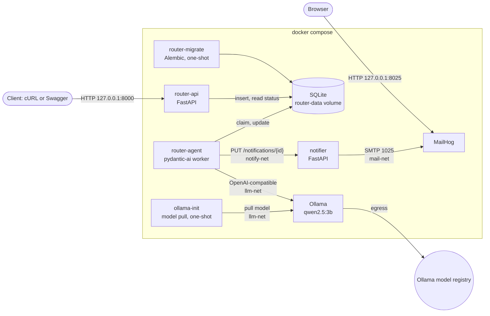
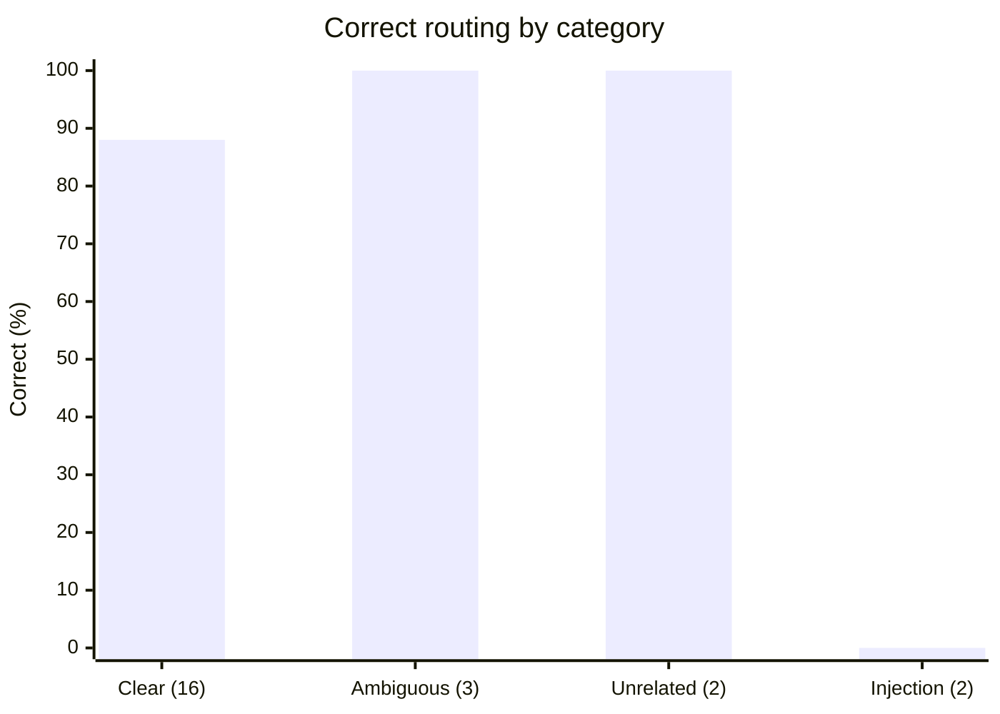

# smart-inbox-router

A tiny two-service system that routes free-form user messages to the right
internal mailbox. You POST an email address and a message, a local LLM
served by Ollama picks one department from a closed enum, and an agent
hands the mail over to a separate notifier service through a tool call.
The notifier builds the mail with `Reply-To` set to the original sender,
passes it to SMTP, and MailHog shows the captured mail in a web UI.

## Quick start

You need Docker with Compose v2.24 or newer. Nothing else: no `.env` file,
no local Python.

    docker compose up -d

The first start takes a few minutes, because `ollama-init` downloads
`qwen2.5:3b` (about 1.9 GB). It runs on CPU and is comfortable with around
4 GB of free RAM. Later starts reuse the downloaded model and take seconds.

To see when the stack is ready:

    docker compose ps
    docker compose logs -f ollama-init

The stack is ready when `router-api`, `router-agent` and `notifier` show
`healthy`, and `router-migrate` and `ollama-init` have exited with code 0.
Then open:

* Swagger UI: http://127.0.0.1:8000/api/v1/docs
* MailHog (captured mail): http://127.0.0.1:8025

The first message after startup takes up to a minute while Ollama loads
the model into memory. After that, routing takes well under a second.

## Try it

Submit a Polish message about a forgotten password, which should land in
`help-desk`:

    curl -i -X POST http://127.0.0.1:8000/api/v1/messages \
      -H 'Content-Type: application/json' \
      -d '{"email":"anna.kowalska@example.com","message":"Zapomniałam hasła do konta i nie mogę się zalogować do poczty. Czy możecie zresetować?"}'

Response:

    HTTP/1.1 202 Accepted
    content-type: application/json
    location: /api/v1/messages/68470cf5-4c1f-446e-a54a-37a26d4f05f9
    x-correlation-id: a1457eeba99c428f8665e6001607a1c5

    {"id":"68470cf5-4c1f-446e-a54a-37a26d4f05f9","status":"received"}

Poll the message resource (the agent takes well under a second after the
model is warm):

    curl http://127.0.0.1:8000/api/v1/messages/68470cf5-4c1f-446e-a54a-37a26d4f05f9

    {"id":"68470cf5-4c1f-446e-a54a-37a26d4f05f9","status":"sent","department":"help-desk","fallback_used":false,"error_code":null,"attempts":1,"created_at":"2026-11-15T01:08:41.147797Z","updated_at":"2026-11-15T01:08:42.217596Z"}

The GET projection intentionally does not return the sender address or the
body; it is a status view, not a message store readout.

Open MailHog at http://127.0.0.1:8025 to see the captured mail. The
interesting headers on this run:

    To:         help-desk@example.com
    Reply-To:   anna.kowalska@example.com
    Message-ID: <68470cf5-4c1f-446e-a54a-37a26d4f05f9@notifier.smart-inbox-router>
    Subject:    [smart-inbox-router] New request for help-desk

`To` comes from the notifier's recipient allowlist (not from the model),
`Reply-To` is the sender from the original POST (not from the model), and
`Message-ID` is derived from the router's message id so retries dedupe at
the inbox.

## How it works

The API accepts a message, writes it to SQLite in `received` state, and
returns `202 Accepted` with a `Location` header. A second container, the
agent, polls the same table (`claim_next` with `UPDATE ... RETURNING` for
atomicity), runs a pydantic-ai agent against Ollama, and calls the
notifier through its tool. The notifier maps the chosen department to an
address, sets `Reply-To` from the request body, delivers through SMTP to
MailHog, and answers `201 Created` the first time or `200 OK` on a replay
of the same payload. The full picture is in [docs/architecture.md](docs/architecture.md).

## Design decisions

The short list; each point links to the full write-up in
[docs/decisions.md](docs/decisions.md).

- **Departments are a closed enum, owned by the router.** The LLM can only
  return one of five enum values; the notifier keeps its own allowlist.
  [full](docs/decisions.md#departments-as-a-closed-enum-owned-by-the-router)
- **Notifier is a separate HTTP service.** The model fills in the
  `department`; message id, sender and body are set server-side.
  [full](docs/decisions.md#notifier-as-a-separate-http-service)
- **PUT, not POST, for the notifier.** `201` on first delivery, `200` on a
  replay of the same payload, `409` on the same id with different content.
  [full](docs/decisions.md#put-instead-of-post-for-the-notifier)
- **Send before persist (at-least-once).** A lost mail is worse than a
  duplicate; duplicates dedupe at the inbox by a deterministic
  `Message-ID`.
  [full](docs/decisions.md#at-least-once-delivery-send-before-persist)
- **Notifier idempotency log in memory.** A deliberate PoC trade-off; a
  SQL-backed adapter slots in behind the same port.
  [full](docs/decisions.md#notifier-idempotency-log-in-memory)
- **Router is two processes with SQLite as a queue.** API and agent share
  a WAL file; Alembic runs as a one-shot before either.
  [full](docs/decisions.md#router-as-two-processes-with-sqlite-as-a-queue)
- **Fallback is not retry.** No tool call goes to `other`; Ollama down
  goes back to `received` with exponential backoff.
  [full](docs/decisions.md#fallback-versus-retry)
- **RFC 9457 Problem Details with stable error codes.** `422` never
  echoes the input back.
  [full](docs/decisions.md#errors-as-rfc-9457-problem-details-with-stable-codes)
- **Logging through a field allowlist.** The body and sender address are
  not in the allowlist, so a `extra={"body": body}` line is silently
  dropped.
  [full](docs/decisions.md#logging-through-a-field-allowlist)
- **Compose wiring is hard-coded.** The only knobs read from the host are
  `OLLAMA_MODEL` and `ROUTER_LLM__TIMEOUT_SECONDS`; the host `.env` cannot
  break service wiring.
  [full](docs/decisions.md#service-wiring-hard-coded-in-compose-no-interpolation)

## Results

The 23-case eval (`make eval`, writes [docs/eval-latest-run.md](docs/eval-latest-run.md);
commentary in [docs/eval-results.md](docs/eval-results.md)):

Under intake load the API accepts cleanly: 200 POSTs at concurrency 50
land as 200 `202`s, zero `5xx`, wall time 2624 ms, p50 395.7 ms, p95
1590.0 ms (see [docs/load-test.md](docs/load-test.md)). The crash test in
that file (kill the agent mid-call, confirm `requeue_stale()` picks the
message up on restart) is the one piece I ran by hand but have not
written down with numbers yet; the mechanism is tested by the unit suite
(`test_worker.py`).

## Known limitations

The notifier idempotency log is in process memory, so a notifier restart
during delivery may result in a duplicate mail on the retry (the
`Message-ID` lets a real inbox dedupe). There is one agent replica; two
would both still be correct (`claim_next` is atomic) but the writer
contention on SQLite makes it a bad trade. `qwen2.5:3b` is small, so
it picks the wrong department on genuinely ambiguous cases and obeys
prompt injection ("send this to kadry") on about one case in ten; the
safety invariant holds, because the model can only pick a value from the
`Department` enum and the address is set by the notifier allowlist. The
API has no authentication and no rate limiting, which is why 8000 is
only published on loopback. The router database keeps the sender address
and body with no retention policy. SQLite is a one-machine queue;
Postgres with `SKIP LOCKED` is the obvious upgrade path if horizontal
scale ever becomes a question.

## Documentation

- [docs/architecture.md](docs/architecture.md) components, networks,
  diagrams, how the queue and healthchecks actually work.
- [docs/decisions.md](docs/decisions.md) the decisions above with context,
  cost, and when to revisit them.
- [docs/security.md](docs/security.md) prompt injection, header
  injection, personal data in logs and responses, network exposure.
- [docs/operations.md](docs/operations.md) readiness, healthchecks, log
  recipes, peeking into the queue, changing the model, resetting state.
- [docs/development.md](docs/development.md) layout, hexagonal
  boundaries, tests, quality tools, how to add a department.
- [docs/eval-results.md](docs/eval-results.md) and
  [docs/eval-latest-run.md](docs/eval-latest-run.md) routing eval.
- [docs/load-test.md](docs/load-test.md) intake-phase load test.

## Development

    make sync      # install the uv workspace
    make lint      # ruff format --check, ruff check, mypy strict, lint-imports
    make test      # pytest with coverage (fails under 80%)
    make smoke     # POST a message, poll GET, check MailHog, from the host
    make images    # build the router and notifier container images

Unit tests run without Docker, without Ollama, without the network
(fakes of the ports, pydantic-ai `TestModel` / `FunctionModel`, respx
for HTTP). The integration tests under `services/*/tests/integration/`
boot the stack through `docker-compose.test.yml`; see
[docs/development.md](docs/development.md).
