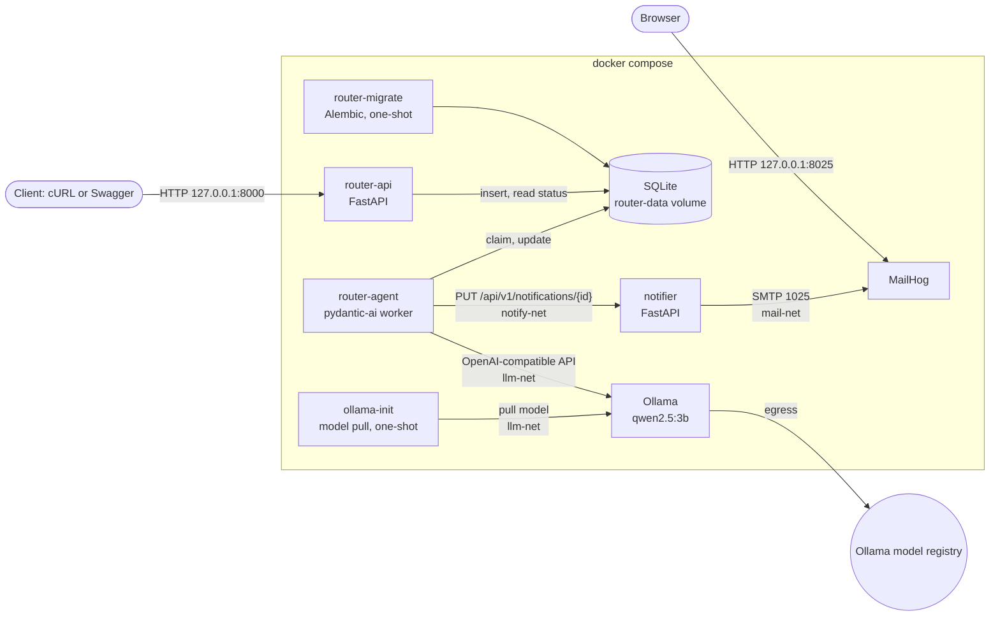
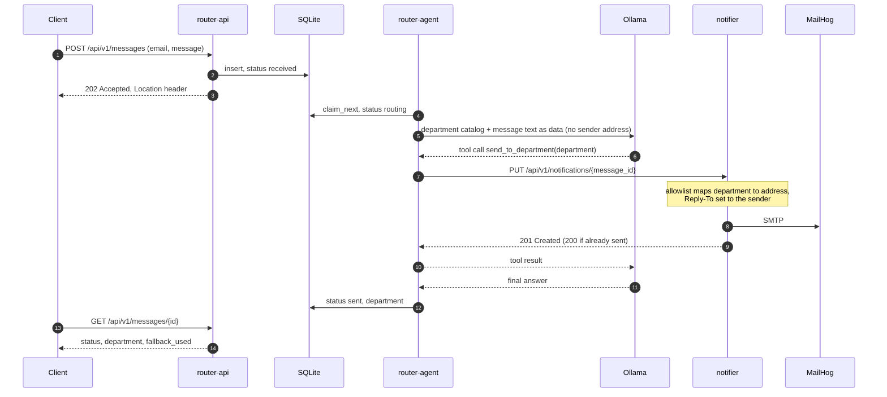
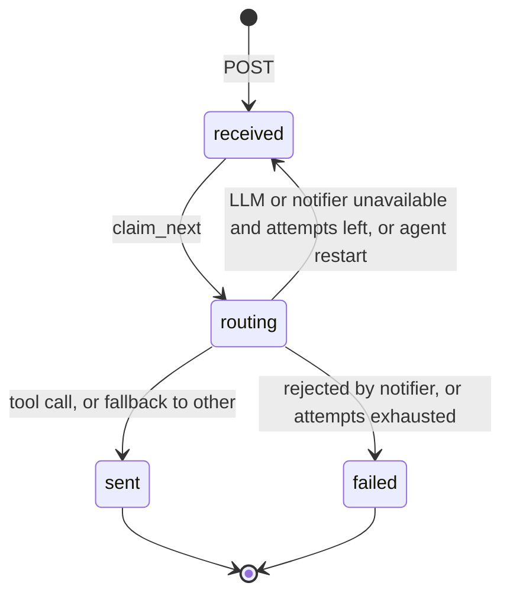
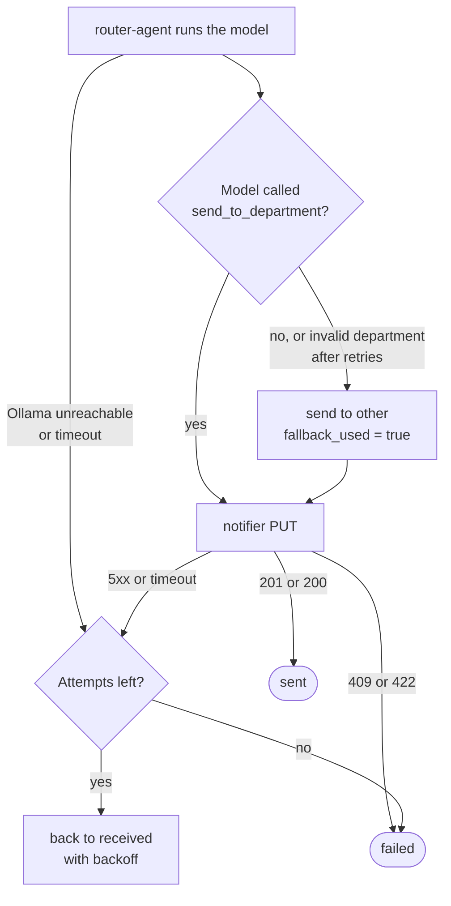

# Architecture

The project is a two-service system behind one HTTP entrypoint. The router
accepts messages, picks a department using a local LLM, and asks a separate
notifier service to send a mail. MailHog catches the mail so you can see
exactly what would go out.

## Components

| Container | Role | Process | Networks | Published port |
| --- | --- | --- | --- | --- |
| `router-api` | HTTP intake; GET status | `uvicorn router.main:app` | `edge` | `127.0.0.1:8000` |
| `router-agent` | Worker loop; pydantic-ai agent | `python -m router.agent_runner` | `llm-net`, `notify-net` | none |
| `router-migrate` | Alembic `upgrade head`, one-shot | `python -m router.migrate` | (default) | none |
| `notifier` | PUT delivery endpoint, SMTP client | `python -m notifier` | `notify-net`, `mail-net` | none |
| `ollama` | Local LLM server | `ollama serve` | `llm-net`, `egress` | none |
| `ollama-init` | Pulls `qwen2.5:3b`, one-shot | `ollama pull` | `llm-net` | none |
| `mailhog` | SMTP sink with web UI | `MailHog` | `mail-net`, `edge` | `127.0.0.1:8025` |

Every long-running container has a `healthcheck` wired into compose; the
one-shot jobs use `restart: "no"` and are gated by
`depends_on: condition: service_completed_successfully`.

## Networks

| Network | `internal` | Members | Purpose |
| --- | :---: | --- | --- |
| `edge` | no | `router-api`, `mailhog` | ports published to loopback |
| `egress` | no | `ollama` | outbound internet to the Ollama registry |
| `llm-net` | yes | `ollama`, `ollama-init`, `router-agent` | OpenAI-compatible calls to the LLM |
| `notify-net` | yes | `router-agent`, `notifier` | router agent calls the notifier |
| `mail-net` | yes | `notifier`, `mailhog` | SMTP delivery |

Only the router API (8000) and MailHog UI (8025) are published, both bound to
`127.0.0.1`. SMTP 1025 is not reachable from the host. Ollama has no
authentication and is never published; it lives on `llm-net` and reaches the
registry only through the `egress` network for the first-run model pull.

## Architecture diagram



## One message, end to end



## Message lifecycle



## Error handling



The distinction between the two left branches is deliberate. "Model answered
but did not pick a department" is treated as a routing miss and sent to
`other` with `fallback_used=true`. "Ollama unreachable or timeout" is an
infrastructure outage; the message goes back to `received` with exponential
backoff (`2 ** attempt`, capped at 60 seconds) and only becomes `failed`
after `max_attempts`. An outage never silently floods the `other` mailbox.

## Where the data lives

The router stores every message in a SQLite file on the named volume
`router-data` (`sqlite+aiosqlite:////data/router.db`), WAL mode. The
`messages` table doubles as the work queue. It carries the sender address and
the full body; there is no retention policy in the PoC. `router-agent` and
`router-api` share this file; `router-migrate` runs Alembic against it before
either service starts.

Ollama stores model weights on the `ollama-models` volume so later starts
reuse the download.

The notifier keeps its idempotency log in process memory, keyed by message
id with a SHA-256 of the payload. A notifier restart loses the log and may
redeliver a message on the next retry; the inbox dedupes by the deterministic
`Message-ID` the notifier sets.

## Queue mechanics

The `messages` table has a `status` column (`received`, `routing`, `sent`,
`failed`), an `available_at` for scheduled retries, and an `attempts`
counter. The worker claims rows with a single atomic statement:

```sql
UPDATE messages
SET status = 'routing', attempts = attempts + 1, updated_at = :now
WHERE id = (
    SELECT id FROM messages
    WHERE status = 'received' AND available_at <= :now
    ORDER BY created_at ASC
    LIMIT 1
)
RETURNING *;
```

(see `SqlMessageRepository.claim_next` in
`services/router/src/router/adapters/sql_message_repository.py`). This is
safe against concurrent workers under SQLite WAL; the second worker gets
`None` and polls again.

On startup the agent calls `requeue_stale()`, which flips every row still
stuck in `routing` back to `received`. That covers the case where the agent
crashed or was `docker compose kill`'d mid-run.

The agent touches `/data/router-agent.alive` every five seconds; the
container's healthcheck fails the liveness probe if the file is more than
thirty seconds old. `stop_grace_period: 130s` in compose covers a full LLM
call (`ROUTER_LLM__TIMEOUT_SECONDS` default is 120 s), so a shutdown gives
the in-flight message a chance to finish before `SIGKILL` lands. The worker
also installs a `SIGTERM` handler that sets `asyncio.Event`, so the main
loop exits between messages on clean shutdown.
