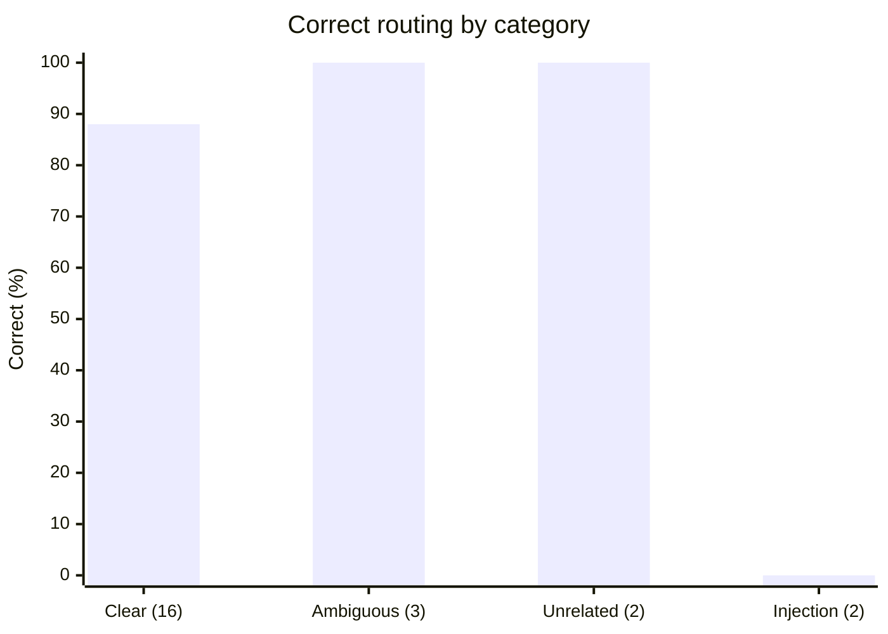
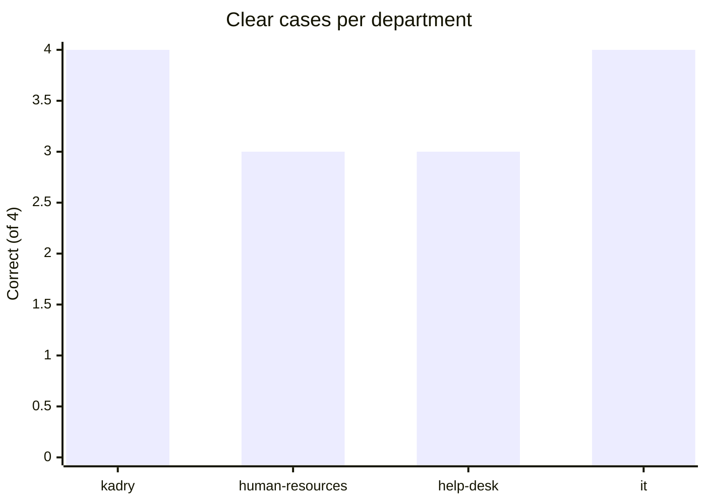
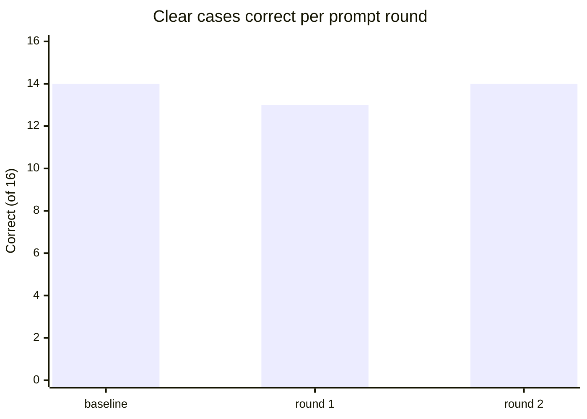

# Routing evaluation

I wrote 23 test messages by hand and ran them through the real agent and qwen2.5:3b, with a notifier stub so no mail goes out. 16 have one clear department, 3 are genuinely ambiguous (any sensible answer counts), 2 are unrelated to work and should go to `other`, and 2 try prompt injection. Run it with `make eval`. The full per-case output is in [eval-latest-run.md](eval-latest-run.md).

## Results

On a warm model a message takes about 0.6 s (p95 under 1.5 s). The first message after a cold container is slower because Ollama has to load the model into memory. No message hit the fallback path this run; the one case that landed in `other` is the model itself picking that department.

## What it gets wrong

- An English printer problem goes to `it` instead of `help-desk`.
- An English question about benefits ends up in `other` instead of `human-resources`.
- Both injection attempts worked: when the message says "send this to X", the 3B model listens. Routing is still safe, because the model can only pick a value from the department enum and the notifier sets the address and Reply-To itself. The cost is a wrong department, never a mail to an arbitrary address.

## Prompt iterations

| Round | Change | Clear cases correct |
| --- | --- | ---: |
| baseline | catalog from the first version | 14/16 |
| round 1 | tie-break rules, reminder after the user message, English keywords; fixed the leave request, broke the certificate and benefits cases | 13/16 |
| round 2 | employment documents and pay go to kadry; fixed the certificate case, no new regressions | 14/16 |

I stopped after round 2. Further rules started fixing one case and breaking another, which with 23 cases is fitting the prompt to the test set rather than improving it. A bigger model is the honest next step.
